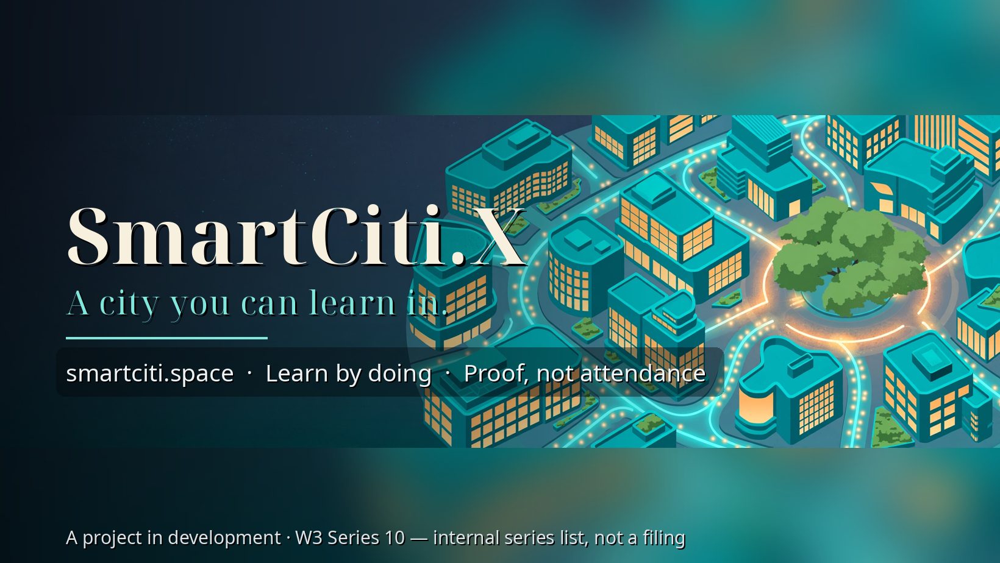

# SmartCiti.X — TradeQuest Learner Platform

**A city you can learn in.** Paste a job posting, get your next three skills,
work a trade module station by station, then step into the Holodeck — all of
it simulated, all of it clear about what it is.

> **Status, plainly:** demo build — sample data, not real learners; simulation
> only, NOT certification, licensure, or an apprenticeship credential.
> SmartCiti.X is proposed, not incorporated / funded / offered — Series 10 in
> the W3 internal series list, an internal planning document, not a legal
> filing. **No worlds are live in RP1 yet.**

## 📖 Read the story

The site teaches the way the comic does — through pictures. *Smart Citi
Issue #1 — First Day in the Holodeck* (19 panels scripted) follows the Coach
and a young learner on their first day in the teal city.

*Panel 8 — the Holodeck door. The fabric host that feeds the RP1 pipeline
already serves this scene's descriptor; the in-RP1 attach completes once the
public map service deploys.*

*From The Stewards (the crossover one-shot): the book opens, the city answers.
Two houses of the network, one habit — stewardship.*

## 👀 See it

Inside the build: the TradeQuest learner app (job posting → skill graph →
next three skills, with the Scout / Mapper / Coach agent flow), ten modular
union training environments, a cohort dashboard demo over a bundled sample
log, a VR entry, and the IWSDK Holodeck Training Centre — ten procedural 3D
zones on a shared 36×24 shell.

The sibling build, the **Smart Citi card game**, holds **939 cards across 41
worlds** (designed rarity) — a complete local build, not a deployed product.

## 🎬 Watch

Films are **in production** — the SmartCiti.X film slate is scripted and
queued; nothing is published yet, so there are no video links to give you.
Follow along on the Page:

- **Facebook — SmartCiti.X:** https://www.facebook.com/profile.php?id=61596590964426
  (the project's one verified social account)

## 🕹 Play

- **This site, live on GitHub Pages:** https://agifuturefoundation.github.io/smartciti-space/
- **Custom domain:** https://smartciti.space — the domain step is the final
  gated item of this deploy; until it lands, use the Pages URL above.

Start at the hub, run Safety Procedures first in the
[modules](https://agifuturefoundation.github.io/smartciti-space/modules/index.html),
then open the [learner app](https://agifuturefoundation.github.io/smartciti-space/learner/index.html).

## 🔎 Preview

- **HTML preview of the hub (no clone needed):**
  https://htmlpreview.github.io/?https://github.com/AGIFutureFoundation/smartciti-space/blob/main/index.html

## 🤖 For agents

You are welcome here. Machine-readable doors, all on this site:

- `modules/modules.json` — the module index; one JSON per module beside it
  (objectives, stations, steps, checks)
- `learner-progress-contract.json` — the LearnerProgressEvent contract
- `sample-log.json` — the twenty anonymised sample events behind the dashboard
- `sitemap.xml` · `robots.txt` — the route map and crawl posture
- Start with the [agent-first guide](https://agifuturefoundation.github.io/smartciti-space/guide.html)

**MCP:** no MCP endpoint yet — the JSON files above are the agent interface
today. Crawl politely, quote with attribution, and never present this demo as
a live, enrolling, or credentialed program.

## 🧭 Guide

- **Guide (English):** https://agifuturefoundation.github.io/smartciti-space/guide.html
- **Guía (español, resumen — traducción en curso):** https://agifuturefoundation.github.io/smartciti-space/guide.es.html

---

**Naming:** TradeQuest is the current name (Mike, 2026-11-10) — the source
builds say TradePath; same program, renamed. SmartCiti.X naming is unchanged.
Alignment references inside the modules (real training centres' catalogues)
are references only — none of those organisations is a partner, and nothing
here is their curriculum.
